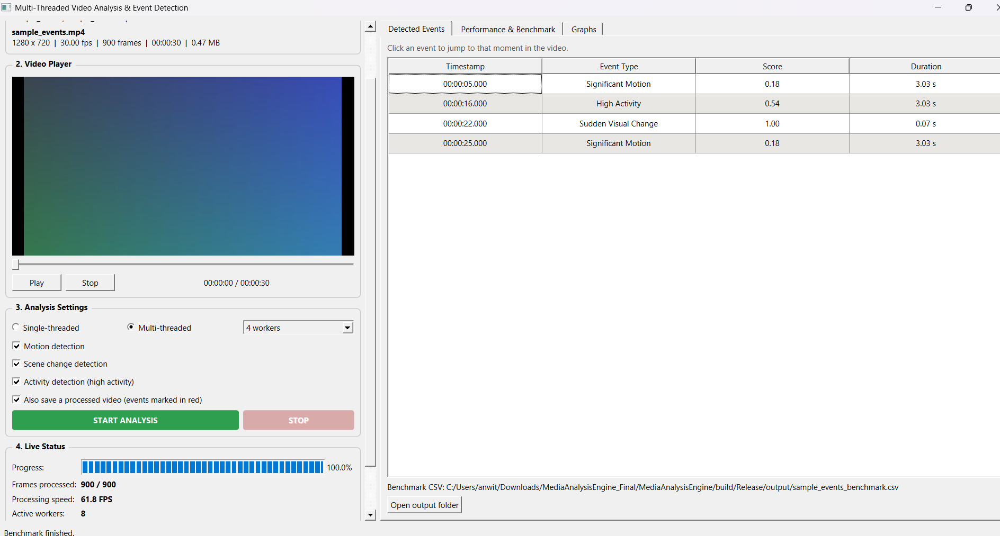
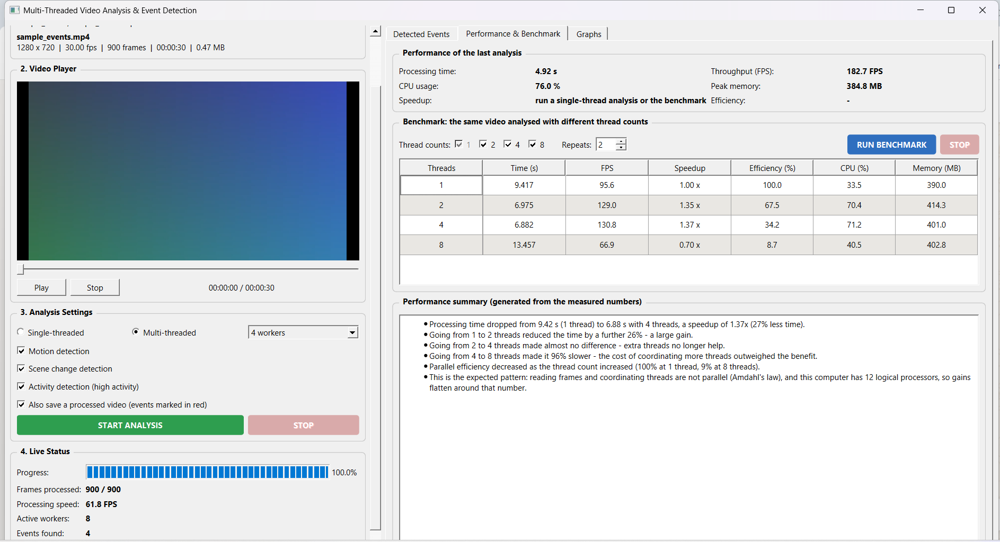
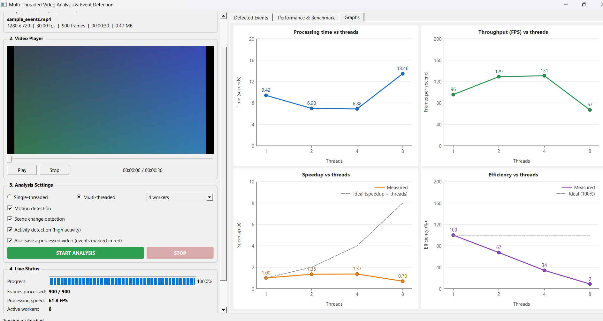
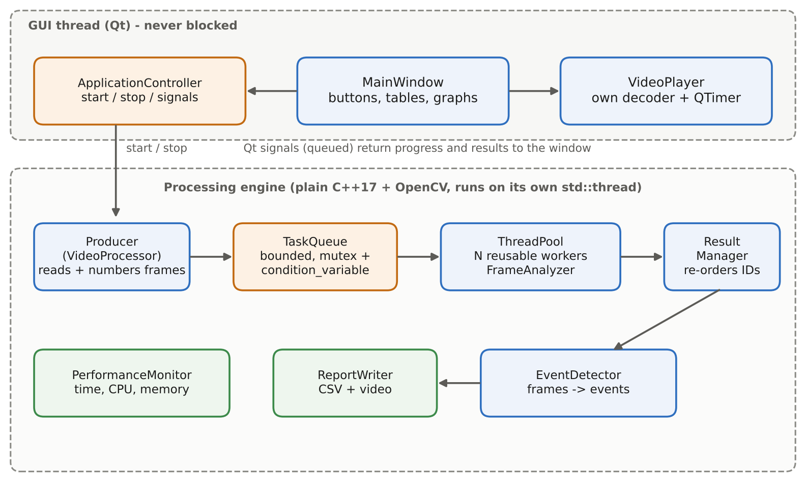
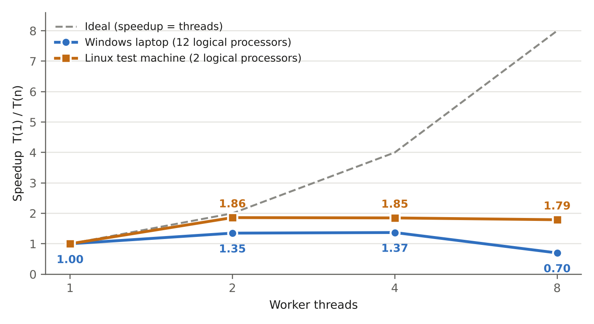
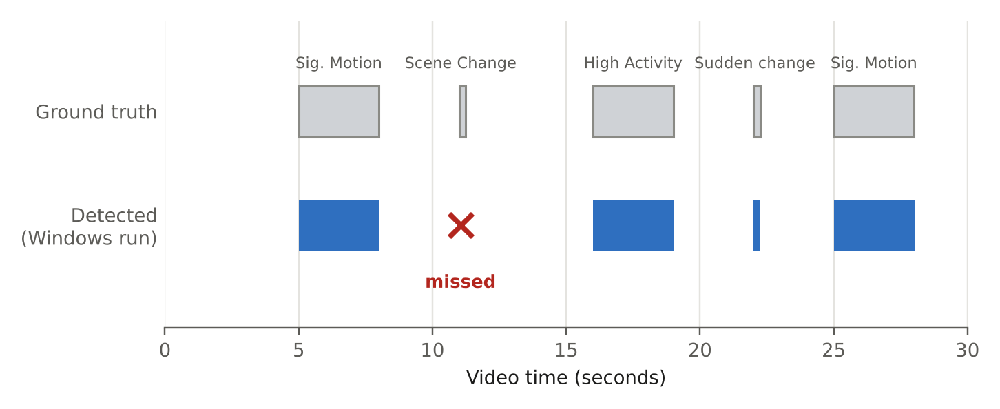

<div align="center">

# SPECTRA
### Multi-Threaded Video Analysis and Performance Monitoring Software Using C++ and OpenCV

*Vellore Institute of Technology, Operating Systems project*

     -brightgreen)

</div>

SPECTRA is a Windows desktop application that scans a video **frame by frame, in parallel**, finds the moments
where something happens (motion, high activity, scene change, sudden flash), and then **measures honestly how
much faster** multi-threading makes the job.


**Team:** Krishna (24BCE0592) · Anushka Sarkar (24BCI0049)


**Submitted to:** Dr. Arthi M ma'am


**Full report:** [docs/SPECTRA_Project_Report.pdf](docs/SPECTRA_Project_Report.pdf)

---

## Screenshots

**Detected events.** Click a row and the video jumps to that moment.



**Performance and benchmark.** Time, FPS, speedup, efficiency, CPU and memory, plus a plain-English summary written from the measured numbers.



**Graphs.** Processing time, throughput, speedup (with the ideal line) and efficiency.



---

## What the app does

| Feature | Details |
|---|---|
| Open a video | Shows resolution, FPS, frame count, duration and file size |
| Built-in player | Play, pause, stop, seek bar, timestamps |
| Analysis | Single-threaded, or multi-threaded with **1 / 2 / 4 / 8** workers; choose Motion, Scene change, Activity |
| Live status | Progress bar, frames processed, speed, active workers, events found |
| Stop | Works at any moment and shuts every thread down safely |
| Events table | Timestamp, event type, score, duration; clicking a row seeks the video |
| Benchmark | Runs 1, 2, 4, 8 threads automatically, with a table, 4 graphs and a written interpretation |
| Output files | `*_events.csv`, `*_benchmark.csv`, `*_processed.avi` saved in `output/` next to the program |

CSV formats: events `timestamp,event_type,score,duration`; benchmark `threads,time,fps,speedup,efficiency,cpu_percent,memory_mb`.

## How it works



```
Producer (reads frames) -> TaskQueue -> ThreadPool: N workers -> ResultManager -> EventDetector
                          (mutex +      (FrameAnalyzer: gray,    (puts results back   (turns frame
                           condition     blur, difference,        in frame-ID order)    measurements
                           variable)     threshold, contours)                           into events)
```

* **Producer-consumer:** one thread reads the video and fills a *bounded* queue; worker threads take frames from it. If workers are slower, the reader waits instead of filling memory.
* **Thread pool:** a fixed set of workers is created once and reused, not one thread per frame.
* **Frame IDs:** workers can finish out of order, so the `ResultManager` releases results in frame order. Events are therefore identical for 1, 2, 4 or 8 threads (checked by a test).
* **Each task carries the current and the previous frame** (shared, not copied), so workers never wait for each other.
* **GUI never freezes:** the engine runs on its own thread and talks to the window through Qt signals.

### How an event is decided (checked in this order, one label per frame)

| Order | Event | Rule |
|---|---|---|
| 1 | Sudden Visual Change | average brightness jumps by 40 or more |
| 2 | Scene Change | at least 10% of pixels changed **and** brightness-histogram distance of at least 0.40 |
| 3 | High Activity | at least 10% of pixels changed |
| 4 | Significant Motion | at least 0.5% of pixels changed |

Nearby detections closer than 0.75 s are merged into one event, and bursts shorter than 3 frames are ignored as noise.

## Results

Formulas: **FPS** = frames / time, **Speedup** = T(1) / T(n), **Efficiency** = Speedup / n x 100%.

**Windows laptop (12 logical processors), 900-frame 1280x720 video**
*(measured with the build before the final fixes described below)*

| Threads | Time (s) | FPS | Speedup | Efficiency | CPU | Memory |
|---|---|---|---|---|---|---|
| 1 | 9.417 | 95.6 | 1.00x | 100.0% | 33.5% | 390.0 MB |
| 2 | 6.975 | 129.0 | 1.35x | 67.5% | 70.4% | 414.3 MB |
| 4 | 6.882 | 130.8 | 1.37x | 34.2% | 71.2% | 401.0 MB |
| 8 | 13.457 | 66.9 | 0.70x | 8.7% | 40.5% | 402.8 MB |

**Linux test machine (2 logical processors), final code**

| Threads | Time (s) | FPS | Speedup | Efficiency |
|---|---|---|---|---|
| 1 | 8.198 | 109.8 | 1.00x | 100.0% |
| 2 | 4.396 | 204.7 | 1.86x | 93.2% |
| 4 | 4.439 | 202.7 | 1.85x | 46.2% |
| 8 | 4.584 | 196.3 | 1.79x | 22.4% |



**What we learned (honestly):**
* Speedup is limited because **video decoding is sequential** (Amdahl's Law) and because OpenCV has its own internal threads.
* On the 12-processor laptop, 8 threads were **slower** than 1; the 8-thread run took about 96% longer than the 4-thread run. We believe thread competition is the cause, but we did not isolate it.
* On the 2-processor machine, 2 threads gave **1.86x** (93% efficiency), so the pool and queue add very little overhead.
* After the Windows run we fixed two things: the scene-change rule (it missed the cut at 11 s) and OpenCV's internal threads (now limited to one during analysis). These fixes were tested on Linux and in the automatic tests. **The Windows benchmark has not been re-run with the fixed build.**

### Detection check against a video with known events

The sample video was generated by a script, so every event time is known. On Windows (original rule) 4 of 5 events were found; with the corrected rule all 5 are found (Linux, and the automatic test).



| Time | What happens | Expected event |
|---|---|---|
| 5 - 8 s | a white box slides across | Significant Motion |
| 11 s | hard cut to a checkerboard scene | Scene Change |
| 16 - 19 s | 22 small boxes jump around | High Activity |
| 22 s | one white flash frame | Sudden Visual Change |
| 25 - 28 s | a yellow box slides back | Significant Motion |

## Quick start (Windows)

Full step-by-step guide: **[docs/INSTALL.md](docs/INSTALL.md)**. Short version, in the *x64 Native Tools Command Prompt for VS 2022*:

```bat
vcpkg install qtbase[core,gui,widgets]:x64-windows opencv4:x64-windows

cmake -S . -B build ^
  -DCMAKE_TOOLCHAIN_FILE=C:/Dev/vcpkg/scripts/buildsystems/vcpkg.cmake ^
  -DVCPKG_TARGET_TRIPLET=x64-windows
cmake --build build --config Release
build\Release\MediaAnalysisEngine.exe
```

Change `C:/Dev/vcpkg` to wherever vcpkg is installed. Then click **Browse Video**, choose `data/sample_videos/sample_events.mp4`, pick a mode and press **START ANALYSIS**.

Optional: automatic tests and the command-line version

```bat
cd build && ctest -C Release --output-on-failure
build\Release\spectra_cli.exe video.mp4 --threads 4
build\Release\spectra_cli.exe video.mp4 --benchmark
```

## Tests

Seven automatic tests (task queue, thread pool, frame analyzer, event detector, result ordering, whole engine, GUI). All seven pass on the Linux development machine; the tests have not been run with `ctest` on Windows.

## Project layout

```
include/ src/        Engine (no Qt):  TaskQueue ThreadPool FrameAnalyzer EventDetector ResultManager
                                      PerformanceMonitor VideoProcessor BenchmarkManager ReportWriter Types
                     GUI (Qt):        MainWindow ApplicationController VideoPlayer VideoView ChartWidget
src/cli_main.cpp     Console version (analysis and benchmark without the GUI)
tests/               The 7 automatic tests
tools/               make_sample_video.py (creates the test video with known events)
data/sample_videos/  sample_events.mp4 and GROUND_TRUTH.md
docs/                INSTALL, ARCHITECTURE, DEMO_SCRIPT, report PDF, images
```

More: [docs/ARCHITECTURE.md](docs/ARCHITECTURE.md) · [docs/DEMO_SCRIPT.md](docs/DEMO_SCRIPT.md)

## Tech stack

C++17 · Qt 6 Widgets · OpenCV 4 (core, imgproc, videoio) · `std::thread`, `std::mutex`, `std::condition_variable`, `std::atomic` · CMake · MSVC (Visual Studio 2022) · vcpkg · CTest
